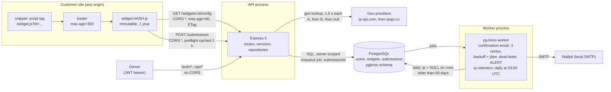

# Embeddable Widget & Lead-Capture Platform

Owners create form widgets (signup, contact), paste one `<script>` line on their site, and visitor
submissions land in a hardened, tenant-isolated backend with geo enrichment, abuse protection and a
background confirmation email.

The submission endpoint is public and callable by anyone, not only by our widget, so every request
is treated as hostile: rate-limited, validated, screened by a honeypot and made idempotent. A valid
lead is always stored against the right tenant, even when the geo providers or the mail server are
down, and bad input always gets a clean 4xx, never a 500.

Built step by step following [docs/PLAN.md](docs/PLAN.md). Design decisions: [docs/DESIGN.md](docs/DESIGN.md).
Proof for every requirement: [EVIDENCE.md](EVIDENCE.md). Build log: [BUILDLOG.md](BUILDLOG.md).

## Architecture

Three actors, three request paths, one API process and one worker process sharing Postgres.



**The submission pipeline**, in order. Each step rejects cheaply before the next, more expensive one runs:

```
POST /submissions
  CORS headers (also on every error) → OPTIONS ends here with 204
  → per-IP limit (10/min, before the body is read)
  → 415 unless JSON → parse at most 10 kB
  → per-widget limit (100/min)
  → validate: Idempotency-Key header, body shape, widget lookup (404), fields against the widget's own schema (422)
  → honeypot: filled → fake 201, nothing stored
  → geo: never throws, null on failure
  → INSERT … ON CONFLICT (widget_id, idempotency_key) → retry returns the original row
  → enqueue the email job (failure only logged) → 201
```

### Which failures reach the visitor (`POST /submissions`)

```
  propagate to the visitor (4xx, request stops)      swallowed and logged (visitor still gets 201)
  ─────────────────────────────────────────────      ─────────────────────────────────────────────
  429  per-IP / per-widget rate limit                 geo: both providers down or slow → geo = NULL
  415  not JSON                                       enqueue: pg-boss unavailable → error log line
  400  malformed JSON      413  body over 10 kB       email: SMTP down → worker retries 3x with
  422  invalid fields or Idempotency-Key                     backoff, then dead-letter queue + ALERT
  404  unknown widget                                 honeypot hit → fake 201, nothing stored
  500  only for our own bugs / DB down (no internals)
```

The rule: a failure the visitor can fix, or that protects us, is returned. A failure in an optional
side effect (geo, email) is never allowed to lose or reject a lead that was otherwise valid.

### Background jobs (worker process)

The worker (`npm run worker`, or included in `npm run start:all`) is a separate process, so slow or
failing background work never touches the API. Both jobs live in Postgres through pg-boss, so they
survive restarts and run once even with several workers.

| Job | When | What it does | When it fails |
| --- | --- | --- | --- |
| `confirmation-email` | queued by the API after each stored submission (job id = submission id, so a retried request never sends a second email) | sends a plain-text confirmation to the widget's email field via SMTP (Mailpit locally) | 3 retries with exponential backoff and jitter (2–4 s, 4–8 s, 8–16 s), then the job is copied to `confirmation-email-dlq` and an `ALERT` line is logged |
| `ip-retention` | scheduled daily at 03:00 UTC (`boss.schedule`, stored in `pgboss.schedule`) | sets `ip = NULL` on submissions older than **90 days**; the lead, its answers and its geo are kept; only the number of cleared rows is logged, never an address | the next day's run clears the same rows |

The code is in `src/jobs/` (`queues.js`: names and policies, `handlers.js`: the two handlers,
`worker.js`: starts the process); the retention SQL is `clearExpiredIps` in
`src/repositories/submissionsRepository.js`.

### Code layout

```
src/
  config/        env parsed with zod; the process refuses to start on a bad value
  http/          routes, middleware (auth, rate limit, error handler), zod schemas
  services/      business logic; no SQL, no req/res; side effects injected
  repositories/  the only place SQL lives; every owner query has  WHERE owner_id = $n
  integrations/  geo providers, mailer
  jobs/          pg-boss queues, worker, handlers (confirmation email, 90-day IP retention)
widget/src/      the embeddable widget (vanilla JS, shadow DOM, textContent only)
test-site/       a second origin (port 5500) with hostile CSS and only the snippet
migrations/      node-pg-migrate, each with up and down
scripts/         seed, attack.js (burst probe), build-widget, start-all
test/            vitest + supertest; one file per probe
```

## Setup

Requires **Node 22+** (see `.nvmrc`) and **Docker**. Every command runs from the repo root.

```bash
git clone https://github.com/elyasbromand/Embeddable-Widget-Lead-Capture-Platform.git
cd Embeddable-Widget-Lead-Capture-Platform
cp .env.example .env          # works locally as is; set a real JWT_SECRET and passwords anywhere else
npm ci
docker compose up -d --wait   # Postgres 17 + Mailpit
npm run migrate up            # create the tables
npm run seed                  # two demo tenants, one widget each
npm run start:all             # API on http://localhost:3000 + the worker (emails, daily IP retention)
```

Then, in other terminals:

```bash
npm run test-site             # the widget on another origin: http://localhost:5500
npm test                      # 98 tests on a fresh test database (<db>_test, recreated every run)
node scripts/attack.js        # burst probe: 10 × 201, then 429s, then 201 after the window
```

- **Mailpit** shows every confirmation email at http://localhost:8025. Nothing leaves the machine.
- **Demo logins:** `tenant-a@example.com` / `tenant-b@example.com`, password `demo-password-123`.
  Their widgets are `lvuvcZeFr-42` (signup, used by the test page) and `cqaxksTr2jOc` (contact).
- **For development**, run `npm run dev` (restarts on change) and `npm run worker` in two terminals
  instead of `start:all`. `npm run migrate down` rolls back one migration.
- **Generate a real secret** with `node -e "console.log(require('crypto').randomBytes(48).toString('hex'))"`.

### Fault injection (off by default, refused when `NODE_ENV=production`)

| Variable | Effect |
| --- | --- |
| `GEO_TEST_IP=8.8.8.8` | Geo looks up this IP instead of the visitor's (locally every visitor is `127.0.0.1`, which is skipped as private). The stored `ip` stays the real one. |
| `GEO_FORCE_DOWN=ip-api.com` | Provider A throws without calling the network (B enriches). `ip-api.com,ipapi.co` = both down (row stored with `geo = NULL`). |
| `FORCE_EMAIL_FAILURE=true` | The worker's mailer always fails: 4 attempts, then the dead-letter queue and an `ALERT` line. Restart the worker after changing it. |

## API

Errors always use one envelope, and no response ever contains a stack trace or SQL:

```json
{ "error": { "code": "VALIDATION_FAILED", "message": "Request validation failed", "details": [{ "path": "email", "message": "Invalid email address" }] } }
```

### Public (customer sites and visitors)

| Method & path | Auth | CORS | Cache | Notes |
| --- | --- | --- | --- | --- |
| `GET /widget.js?id=<widgetId>` | none | n/a (script tag) | `public, max-age=300` | Loader; inserts the current hashed bundle |
| `GET /widget.<hash>.js` | none | n/a | `public, max-age=31536000, immutable` | The widget bundle; name changes with its content |
| `GET /widgets/:id/config` | none | `*`, no credentials | `public, max-age=60` + ETag/304 | Title, fields, display; never `owner_id` |
| `OPTIONS /submissions` | none | preflight, `Max-Age: 7200` | | 204 |
| `POST /submissions` | none | `*`, exposes `Retry-After` | none | Body `{ widgetId, fields, website? }`, optional `Idempotency-Key: <uuid>` header. 201 `{ id, createdAt }` |
| `GET /health` | none | | | `{ "status": "ok", "db": "ok" }`, or 503 when the database is down |

### Owner (send `Authorization: Bearer <token>`)

| Method & path | Body / query | Response |
| --- | --- | --- |
| `POST /auth/register` | `{ email, password }` (8–256 chars) | 201 `{ user, token }` (409 if the email exists) |
| `POST /auth/login` | `{ email, password }` | 200 `{ user, token }`, one generic 401 for any failure |
| `POST /api/widgets` | `{ type: "signup" \| "contact", title, description?, buttonText, fields: [{ name, label, type: "text" \| "email" \| "textarea", required? }], display?: { theme?, accentColor? } }` | 201 widget **with its embed `snippet`** |
| `GET /api/widgets` | | 200 the owner's widgets |
| `GET /api/widgets/:id` | | 200, or 404 (also for another tenant's widget) |
| `PATCH /api/widgets/:id` | any subset of the create fields | 200 / 404 |
| `DELETE /api/widgets/:id` | | 204 / 404 (deletes its submissions too) |
| `GET /api/submissions` | `?widgetId=&limit=1..100 (20)&cursor=` | 200 `{ items: [{ id, widgetId, data, geo, createdAt }], nextCursor }`, newest first; pass `nextCursor` back for the next page |
| `GET /api/stats/overview` | `?days=1..90 (30)` | 200 `{ totals: { total, last24h }, perWidget, perDay: { days, counts }, byCountry }`, all counted in SQL |

Another tenant's widget always gets the same 404 as one that does not exist. Unknown keys in any
body or query are a 422. The visitor's IP is never returned by the API.

### Try it with curl

```bash
# visitor (any origin)
curl -i -X POST localhost:3000/submissions -H "Content-Type: application/json" \
  -H "Idempotency-Key: $(node -e "console.log(crypto.randomUUID())")" \
  -d '{"widgetId":"lvuvcZeFr-42","fields":{"email":"ada@example.com","first_name":"Ada"}}'

# owner
TOKEN=$(curl -s -X POST localhost:3000/auth/login -H "Content-Type: application/json" \
  -d '{"email":"tenant-a@example.com","password":"demo-password-123"}' | node -pe "JSON.parse(require('fs').readFileSync(0)).token")
curl -s localhost:3000/api/submissions?limit=5 -H "Authorization: Bearer $TOKEN"
curl -s localhost:3000/api/stats/overview?days=7 -H "Authorization: Bearer $TOKEN"
```

## Limitations

Known and accepted for this scope. Each would need more work before real production use.

- **Rate limits are in memory.** Counts reset when the server restarts and are not shared between
  processes, so two instances would each allow the full limit. The real fix is a shared store
  (Postgres or Redis).
- **Fixed window.** A client can send 10 requests at the end of one minute and 10 more at the start
  of the next, so up to 20 in a few seconds. A sliding window would smooth that out.
- **Per-IP limit and shared networks.** Visitors behind one IP (an office, a mobile carrier) share
  the 10/min limit.
- **Per-widget limit can be used against a tenant.** An attacker with many IPs can use up a widget's
  100/min and block real visitors to that widget for the rest of the minute.
- **Made-up widget ids.** A random id in the correct format gets its own per-widget key and reaches a
  database lookup (then 404). Only the per-IP limit caps this.
- **Raw IPs are personal data.** Each submission stores the visitor's IP (from the connection, never
  the body) so rows without geo could be re-enriched and abuse investigated. It is never logged and
  never returned to owners, and a daily worker job clears it after **90 days** (`ip-retention`,
  03:00 UTC); the lead and its geo stay. There is **no endpoint to delete one visitor's data**, so a
  deletion request would mean a manual SQL delete.
- **Geo is an estimate, and the free tiers are small.** The two providers disagree for the same IP
  (8.8.8.8: Ashburn vs Mountain View). ip-api.com's free tier is **HTTP only** (the visitor IP crosses
  the network unencrypted) and allows 45 lookups a minute; ipapi.co allows about 1,000 a day. Above
  that they answer 429, the chain falls through, and rows are stored with `geo = NULL`. There is no
  per-IP cache and no backfill job. This happened during testing: with ip-api.com forced down,
  ipapi.co timed out and then answered 429, so a row was stored without geo.
- **Geo adds latency to the submission.** The lookup runs before the insert: about 0.3–1 s normally,
  up to 1.5 s per provider when one hangs (3 s worst case with both).
- **A lost enqueue is only logged.** The insert and the job are two separate writes. If pg-boss is
  unavailable at that moment, the lead is stored but no email is queued, and only an error log line
  records it. Sending the job in the same transaction as the insert (or a backfill for submissions
  without a job) would close that gap.
- **The alert is a log line.** `ALERT` is written to the worker log; nothing pages a person. A real
  deployment would ship that line to an alerting tool.
- **Confirmation emails go to unverified addresses.** Anyone can make us send one confirmation email
  to any address by submitting it (capped by the rate limits). The email contains no link and no
  visitor-supplied text other than the widget title, which limits the abuse, but a real deployment
  would need double opt-in or a per-recipient cap.
- **Idempotency keeps the first version.** A retry with the same key returns the original submission,
  even if the data changed, so the widget makes a new key when the form changes.
- **JWTs cannot be revoked.** A token stays valid until it expires (1 hour); there is no logout list
  and no refresh token.
- **Local setup only.** No HTTPS, no deployment config. `PUBLIC_BASE_URL` must be `https://` in any
  real deployment, and the placeholder secrets in `.env.example` must be replaced.

## AI use

**The product itself uses no AI**: no model is called at runtime, so there is no AI cost to track.
AI assistance during development (Claude Code) is logged honestly, step by step, in
[BUILDLOG.md](BUILDLOG.md): what it wrote, where it was wrong, and what I changed.

## License

[MIT](LICENSE)
